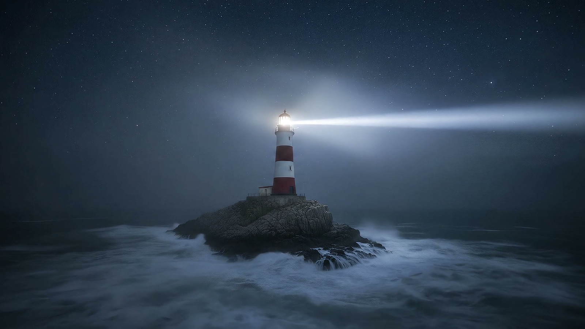

# Animated Wallpapers

Give your Mac a moving desktop and a matching Lock Screen. The native menu bar app includes **301 GifPaper wallpapers** and their matching login and profile pictures.

[**Download for Mac**](https://github.com/vDeimos/animated-wallpapers/releases/download/v2.3.9/Animated-Wallpapers-Installer.zip) · [Release notes](https://github.com/vDeimos/animated-wallpapers/releases/tag/v2.3.9) · [Project page](https://vdeimos.github.io/animated-wallpapers/)



## Install

**Apple silicon · macOS 26 or later · Administrator account**

1. Download and unzip **Animated-Wallpapers-Installer.zip**.
2. Open **Open Installer.command**. It downloads and verifies the three archive parts, decrypts them, and opens the macOS Installer. Allow roughly **20 GB** of free space during setup.
3. After installation, open **Animated Wallpapers** from Applications. The first-launch wizard guides you through choosing and applying a wallpaper, optional Open at Login, and optional Apple Account photo sync.

The application uses an ad-hoc signature and the installer package is unsigned. macOS may ask you to approve opening it.

## How it works

- **Desktop and Lock Screen.** Apply a wallpaper once. The desktop starts looping immediately, and a background helper prepares the matching Lock Screen video.
- **Menu bar controls.** The Dock icon appears while you choose a wallpaper. It disappears after the chooser closes, while playback continues.
- **Matching pictures.** Applying a wallpaper updates the Mac login picture. Apple Account photo sync is optional and asks you to authorize the app in System Settings.
- **Open at Login.** Enable this in setup or from the menu bar to resume your wallpaper when you sign in.

The Lock Screen integration uses macOS’s Aerial catalog and can require maintenance after a macOS update. The workflow was tested on macOS 27.3.

## Build from source

Install Xcode or its Command Line Tools. Use a wallpaper library with videos in **4K Wallpapers**, matching JPEGs in **Desktop Stills**, and matching PNGs in **User Icons**. Each trio uses the same base filename.

```sh
./scripts/build-release.sh "/path/to/Gifpapers" "/path/to/output"
```

The script produces a standard macOS installer package for Apple silicon. The release page also provides the full media catalog as verified Apple Encrypted Archive parts.

Wallpaper artwork by GifPaper, distributed with permission. [Rights and credits](NOTICE.md)
